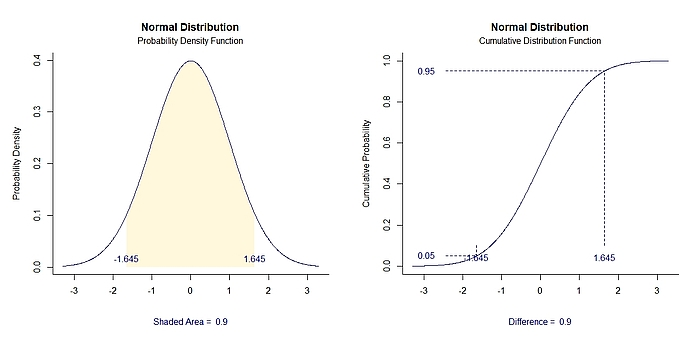

# [`plotDistributions`](https://github.com/cwendorf/plotDistributions)

## Visualizing Probability Distributions

[](https://cran.r-project.org/)
[](https://github.com/cwendorf/plotDistributions/releases/latest)
[](https://www.repostatus.org/#inactive)

### Overview

`plotDistributions` is a small R package for plotting the probability density and cumulative distribution functions for various continuous distributions. It provides functionality to highlight probabilities and display critical values.



### Installation

This package is not currently available on CRAN. It can be installed directly from GitHub:

``` r
if (!requireNamespace("remotes", quietly = TRUE)) install.packages("remotes")
remotes::install_github("cwendorf/plotDistributions")
library(plotDistributions)
```

If you prefer not to install the package, you can load the current functions directly:

```r
source("https://raw.githubusercontent.com/cwendorf/plotDistributions/main/source-plotDistributions.R")
```

### Usage

This package includes the following documentation:

- [Introduction](./docs/README.md):  Overview of the package and links to all resources.
- [Reference](./docs/man/README.md): Documentation for all exported functions, including usage, arguments, and return values.
- [Articles](./docs/vignettes/README.md): Examples demonstrating how to use the package.

### Citation

Wendorf, C.A. (2022). *plotDistributions: Visualizing probability distributions* [R Package]. [https://github.com/cwendorf/plotDistributions](https://github.com/cwendorf/plotDistributions)
