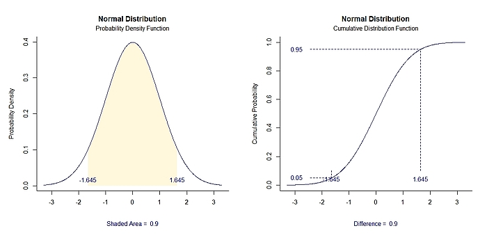

# [`plotDistributions`](https://github.com/cwendorf/plotDistributions)

## Introduction

Understanding a probability distribution can require examining its density, cumulative probabilities, and critical values. `plotDistributions` provides visual tools for exploring these features across distribution families.

- [Overview](#overview)
- [Resources](#resources)

---

### Overview

`plotDistributions` plots probability density or mass functions and cumulative distribution functions for continuous and discrete distributions. Its tools can highlight probabilities and display critical values.

### Resources

- [Reference](./man/README.md): Documentation for all exported functions, including usage, arguments, and return values.
- [Articles](./vignettes/README.md): Examples demonstrating how to use the package.
